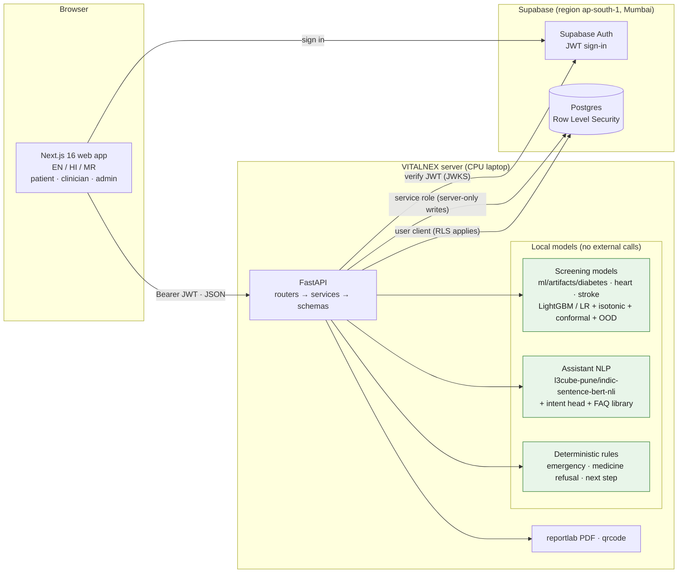

# VITALNEX

**Multilingual (English / Hindi / Marathi) health screening and care-navigation MVP for patients
and clinicians.**

> **Not a diagnostic tool.** VITALNEX is a screening and care-navigation prototype. It does not
> diagnose disease, does not name or dose medicines, and does not replace a doctor. All accounts
> are demo accounts. In an emergency call **108 / 112** (India).

## What VITALNEX is

A person answers 14 self-reported questions (age, sex, height, weight, high blood pressure, high
cholesterol, smoking, activity, fruit, vegetables, heavy alcohol, general health, poor mental and
physical health days, difficulty walking), plus optional symptom ticks and free text. For three
conditions — **diabetes/prediabetes, heart disease or heart attack, and stroke** — VITALNEX shows:

- a **screening level**: Low / Moderate / High, or "Not confident — please see a doctor";
- the **main factors** behind it, in plain language;
- **what could change it** (only changeable factors);
- a **next step**: routine check-ups / discuss at your next check-up / see a doctor soon /
  emergency (call 108 / 112).

Clinicians get a review queue (High and not-confident cases of patients who consented to share),
and can agree or override with a required reason; every override is logged. Admins see governance:
model cards, fairness tables, override rates, audit log. A public **Trust Passport** (`/ai-trust`)
explains how the AI works and where it fails, mapped to NITI Aayog's Responsible AI principles.

Key design choices: small predictive models only (no generative AI); all ML and NLP run locally on
a CPU laptop; no health data goes to any third-party API; emergency red flags override everything;
the models abstain when they are not confident. Details: [`docs/SPEC.md`](docs/SPEC.md),
decisions: [`docs/DECISIONS.md`](docs/DECISIONS.md), responsible-AI report:
[`docs/ERAI_REPORT.md`](docs/ERAI_REPORT.md).

## What VITALNEX is not

- Not a diagnosis ("Your answers are similar to people who have been told they have …"), not a
  prescription, not a replacement for a doctor.
- Not validated on Indian patients. The models are trained on the US CDC BRFSS 2015 survey
  (253,680 rows). See the [data card](docs/data_card.md) and the model cards.
- Not a product with real users. All accounts and the demo history are synthetic. The Pune
  synthetic dataset in `data/synthetic/` is used only for demo profiles and stress tests, never for
  training or reported metrics (D-4).

## Architecture



More diagrams (ML training pipeline, assessment request flow, next-step rules, database ER diagram,
NITI Aayog principle map): [`docs/ARCHITECTURE_DIAGRAMS.md`](docs/ARCHITECTURE_DIAGRAMS.md).

```
apps/api/        FastAPI backend (routers/v1 → services → schemas, core, content/, assets/fonts)
apps/web/        Next.js 16 app (src/app pages, components, src/messages/{en,hi,mr}.json)
ml/data/         BRFSS download, preparation, stats.json, splits
ml/training/     training, calibration, conformal, OOD, fairness, mitigation, SHAP, model cards
ml/artifacts/    <diabetes|heart|stroke>/ model.joblib, calibrator, conformal, ood, model_meta.json
ml/nlp/          assistant: intent data, FAQ, encoder wrapper, rules, train_intents, artifacts/
supabase/        migrations/, seed/ (seed_demo.py, seed_history.py), tests/rls.sql
data/synthetic/  Pune synthetic dataset — demo profiles and stress tests only
tests/           pytest (api, ml, nlp, live Supabase)
docs/            SPEC, DECISIONS, ERAI report, cards, diagrams, demo script, review lists
```

## Setup from scratch

Requirements: **Python 3.11+** (developed on 3.13), **Node.js 20+**, a free **Supabase** project,
about 3 GB of disk for Python packages and the local NLP encoder. CPU only; no GPU, no paid APIs.

### 1. Clone and install

Linux / macOS:

```bash
python3 -m venv .venv && source .venv/bin/activate
pip install -r apps/api/requirements.txt -r ml/requirements.txt
npm install                      # repo root (concurrently)
npm --prefix apps/web install
```

Windows (PowerShell):

```powershell
python -m venv .venv; .venv\Scripts\Activate.ps1
pip install -r apps/api/requirements.txt -r ml/requirements.txt
npm install
npm --prefix apps/web install
```

(Git Bash on Windows: `source .venv/Scripts/activate`.)

### 2. Supabase project and `.env`

1. Create a project at <https://supabase.com> (any region; ours is Mumbai).
2. Copy the template and fill it in. **Never commit `.env`.**

   ```bash
   cp .env.example .env            # PowerShell: Copy-Item .env.example .env
   ```

   Needed: `NEXT_PUBLIC_SUPABASE_URL`, `NEXT_PUBLIC_SUPABASE_PUBLISHABLE_KEY`, `SUPABASE_URL`,
   `SUPABASE_SECRET_KEY` (server only), `DEMO_PASSWORD` (your choice; shared by all demo
   accounts). Optional: `SUPABASE_ACCESS_TOKEN` (to apply migrations via the Management API),
   `SUPABASE_JWT_SECRET` (only for legacy HS256 projects), `PROBLEM_REPORT_CONTACT`. The variables
   under "NOT USED in the MVP" are not read by any code.

### 3. Apply the database migrations

Apply the files in `supabase/migrations/` **in filename order**:

1. `20260927000001_initial_schema.sql`
2. `20261026000001_p1_auth_persistence.sql`
3. `20261028000001_p7_share_revoke_guard.sql`

Either paste each file into the Supabase **SQL editor** and run it, or use the **Management API**
with a personal access token (`<ref>` is your project ref):

```bash
# Linux / Git Bash; needs jq
for f in supabase/migrations/*.sql; do
  jq -Rs '{query: .}' "$f" | curl -sS -X POST \
    "https://api.supabase.com/v1/projects/<ref>/database/query" \
    -H "Authorization: Bearer $SUPABASE_ACCESS_TOKEN" -H "Content-Type: application/json" -d @-
done
```

Then prove Row Level Security: run `supabase/tests/rls.sql` in the SQL editor; it should end with
"all RLS checks passed". New schema changes go in new migration files; never edit an applied one.

### 4. Data (only needed to retrain)

The trained artifacts in `ml/artifacts/` and `ml/nlp/artifacts/` are committed, so the app runs
without this step. To reproduce them:

```bash
python -m ml.data.download       # CDC BRFSS 2015 (UCI id 891) -> data/raw/ (git-ignored)
python -m ml.data.prepare        # checks, stats.json, splits, data/processed/brfss2015.parquet
python -m ml.data.data_card      # regenerates docs/data_card.md
```

If the automatic download fails, the script prints manual Kaggle instructions.

### 5. Training (optional; overwrites the committed artifacts)

```bash
python -m ml.training.train_all     # 3 diseases: compare LR / LightGBM / MLP, calibrate,
                                    # conformal, OOD, fairness, SHAP, model cards
python -m ml.training.mitigation    # per-age-threshold experiment -> docs/fairness_mitigation.md
python -m ml.nlp.train_intents      # assistant intent model -> ml/nlp/artifacts/
```

The assistant encoder `l3cube-pune/indic-sentence-bert-nli` (CC-BY-4.0) is downloaded once from
Hugging Face on first use and then runs locally. Only the model is downloaded; no user text is
sent anywhere. Retraining changes the numbers in the model cards; the docs quote the committed
artifacts.

### 6. Seed demo data

```bash
python supabase/seed/seed_demo.py      # accounts, doctors, slots, consents (idempotent;
                                       # resets passwords to DEMO_PASSWORD)
python supabase/seed/seed_history.py   # demo assessment history made by running the real models
```

The history seed replaces earlier demo assessments (`assessment_mode = 'demo'`). It prints the
next step of each visit; patient1's latest visit is a High case ("see_doctor_soon (queued)") for
the clinician-review demo.

### 7. Run

```bash
uvicorn apps.api.main:app --reload --port 8000   # API: http://localhost:8000/docs
npm --prefix apps/web run dev                    # web: http://localhost:3000
# or both at once from the repo root:
npm run dev
```

### 8. Tests

```bash
python -m pytest tests -v                        # live Supabase tests need a configured .env
python -m pytest tests -q --deselect tests/test_live_supabase.py   # offline only
npm --prefix apps/web run lint
npm --prefix apps/web run build
npm --prefix apps/web run i18n:check             # EN/HI/MR message keys match
```

## Demo accounts

All synthetic. Password = the `DEMO_PASSWORD` you set in `.env`.

| Account | Role | Notes |
|---|---|---|
| `admin@vitalnex.demo` | Admin | Governance, fairness, override analytics, audit log |
| `dr.joshi@vitalnex.demo` | Clinician | Cardiology |
| `dr.khan@vitalnex.demo` | Clinician | Endocrinology |
| `dr.patil@vitalnex.demo` | Clinician | Neurology |
| `patient1@vitalnex.demo` | Patient | English, shares with clinicians; latest demo visit is High |
| `patient2@vitalnex.demo` | Patient | Hindi, shares; demo visits are "not confident" |
| `patient3@vitalnex.demo` | Patient | Marathi, shares |
| `patient4@vitalnex.demo` | Patient | English, shares; demo visits are "not confident" |
| `patient5@vitalnex.demo` | Patient | Hindi, does not share |
| `patient6@vitalnex.demo` | Patient | Marathi, does not share |

A 10-minute walk-through: [`docs/DEMO_SCRIPT.md`](docs/DEMO_SCRIPT.md).

## Documentation

| Document | What it is |
|---|---|
| [`CLAUDE.md`](CLAUDE.md) | Project context and the hard rules ("what VITALNEX must never do") |
| [`docs/SPEC.md`](docs/SPEC.md) | Product and technical specification |
| [`docs/DECISIONS.md`](docs/DECISIONS.md) | Decision log D-1 … D-26 with ERAI reasoning |
| [`docs/ERAI_REPORT.md`](docs/ERAI_REPORT.md) | Responsible-AI report: principle map, risk register, fairness, limitations, sign-offs |
| [`docs/ARCHITECTURE_DIAGRAMS.md`](docs/ARCHITECTURE_DIAGRAMS.md) | Six Mermaid diagrams |
| [`docs/data_card.md`](docs/data_card.md) | BRFSS 2015 data card |
| [`docs/model_cards/`](docs/model_cards/) | Model cards: diabetes, heart, stroke, assistant |
| [`docs/fairness_mitigation.md`](docs/fairness_mitigation.md) | Per-age-threshold experiment (not adopted, D-24) |
| [`docs/api_examples.md`](docs/api_examples.md) | API request / response examples |
| [`docs/redteam_report.md`](docs/redteam_report.md) | Red-team checklist results (SPEC §8.2) |
| [`docs/claims_audit.md`](docs/claims_audit.md) | Where every metric and claim comes from |
| [`docs/i18n_review.md`](docs/i18n_review.md), [`docs/i18n_review_p8.md`](docs/i18n_review_p8.md) | Hindi / Marathi wording awaiting human review |
| [`docs/DEMO_SCRIPT.md`](docs/DEMO_SCRIPT.md) | 10-minute demo walk-through |
| [`docs/PROGRESS.md`](docs/PROGRESS.md) | Build progress and handoff notes |
| [`docs/PROMPTS.md`](docs/PROMPTS.md) | Phase prompts used to build the MVP |
| [`docs/AUDIT.md`](docs/AUDIT.md) | Audit of the original repository before the rebuild |

## Known limitations (short)

US training data, not validated in India; 37–44% of test people get "not confident" for a
condition; results are much less reliable for people under 40; Hindi/Marathi medical wording not
yet reviewed by a human; signed-in pages not yet clicked through with an automated browser. Full
list: [`docs/ERAI_REPORT.md`](docs/ERAI_REPORT.md) §5 and §7.
