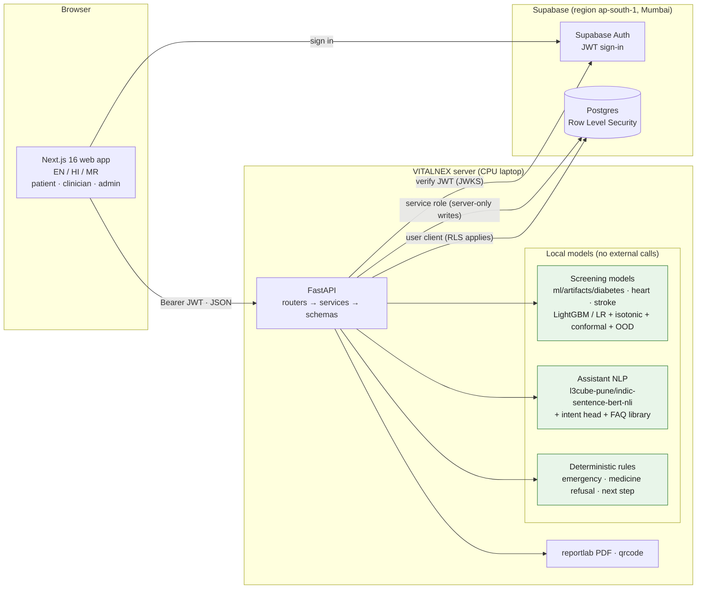
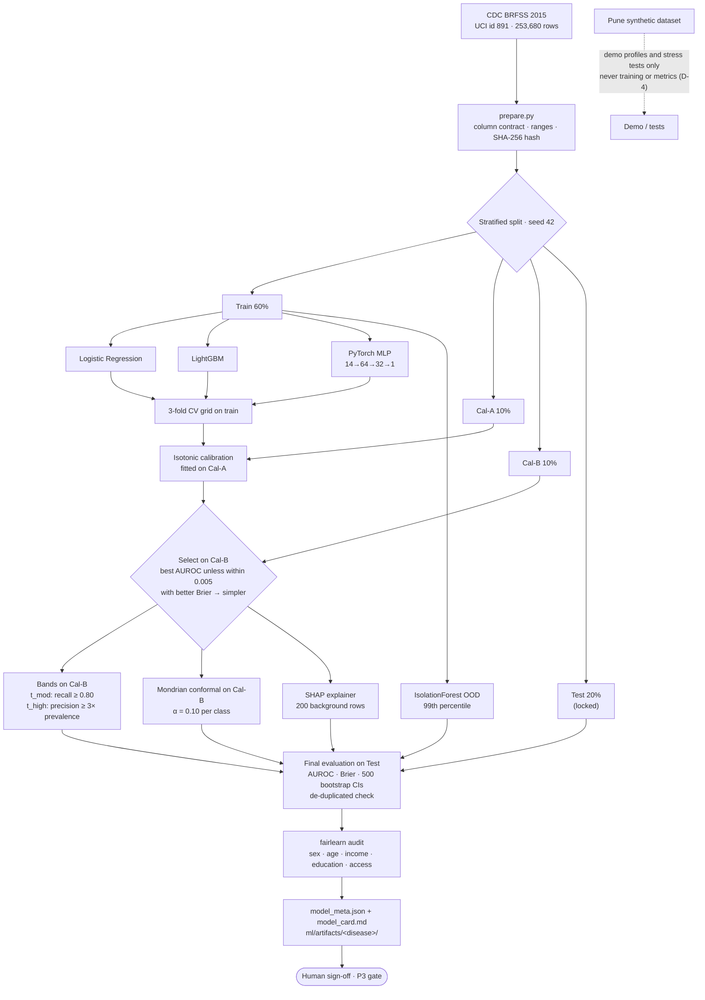
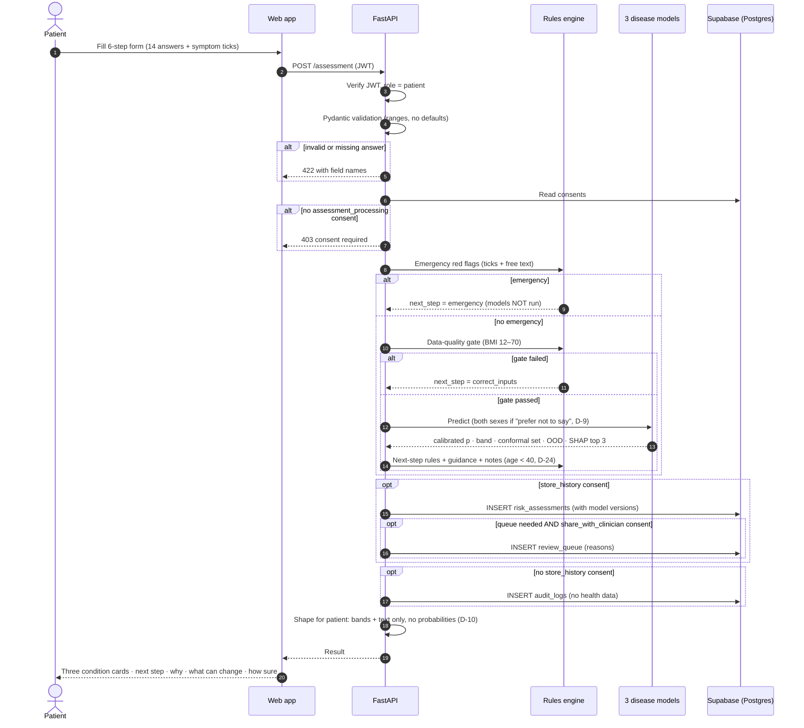
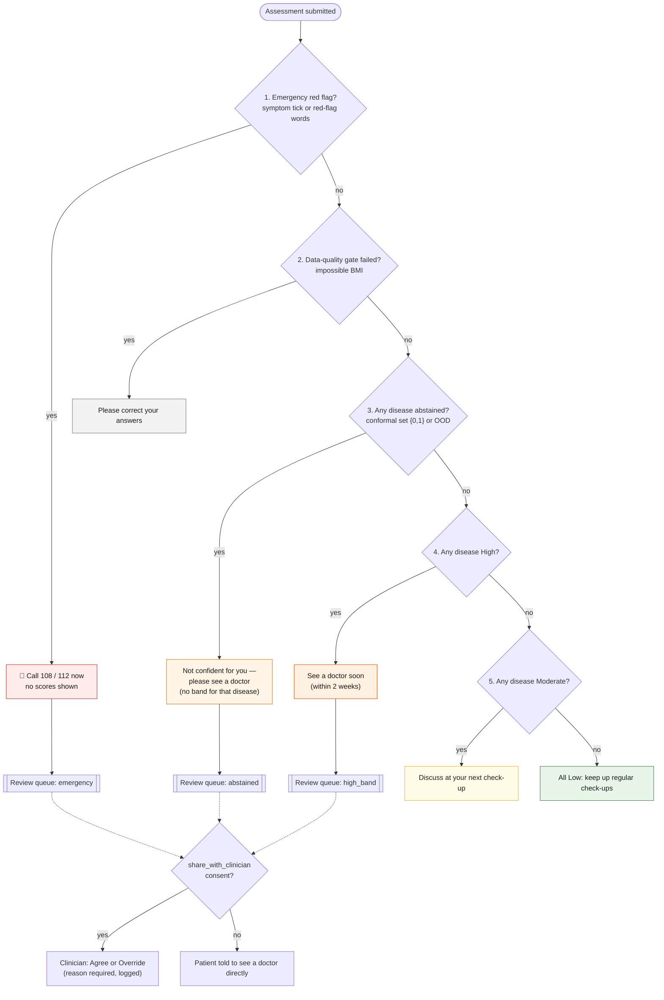
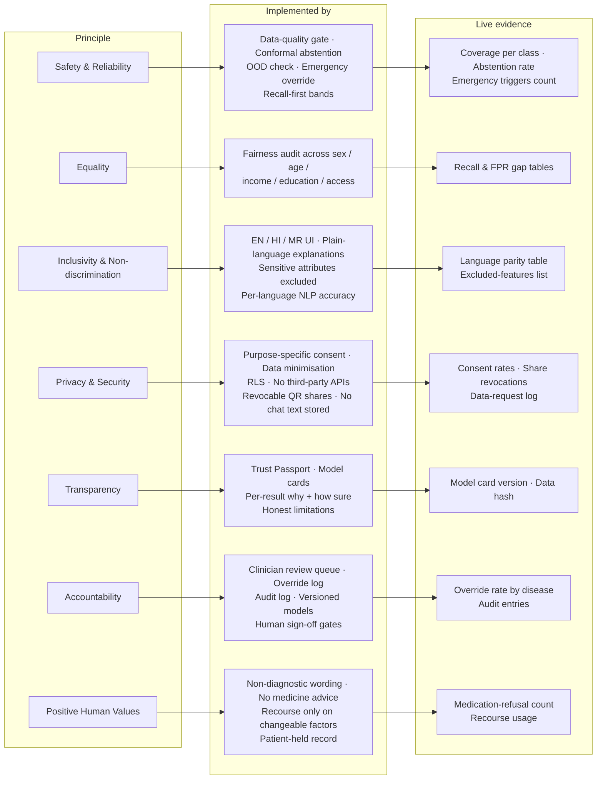

# VITALNEX — Architecture diagrams

Six core diagrams, written in Mermaid. They render on GitHub, in VS Code (with a Mermaid preview
extension) and at <https://mermaid.live>. Every component, table, threshold and number below is
taken from the code, `ml/artifacts/<disease>/model_meta.json` or `docs/DECISIONS.md`.

1. [System architecture](#1-system-architecture)
2. [ML training pipeline](#2-ml-training-pipeline)
3. [Assessment request flow](#3-assessment-request-flow)
4. [Next-step decision rules](#4-next-step-decision-rules)
5. [Database ER diagram](#5-database-er-diagram)
6. [NITI Aayog principle traceability map](#6-niti-aayog-principle-traceability-map)

---

## 1. System architecture

Everything that touches health data runs on the VITALNEX server. No third-party AI or analytics API
is called (CLAUDE.md hard rule 6).

| Layer | Technology | Responsibility |
|---|---|---|
| Web | Next.js 16, React 19, Tailwind, Recharts | Forms, results, clinician and admin workspaces, Trust Passport |
| API | FastAPI, Pydantic v2 | Validation, rules, model scoring, role-shaped responses, audit |
| ML | scikit-learn, LightGBM, PyTorch (CPU), SHAP, fairlearn | 3 screening models + calibration, abstention, explanations |
| NLP | sentence-transformers (local encoder) | Intent classification and FAQ retrieval, no generated text |
| Data | Supabase Postgres + Auth + RLS | Accounts, consents, assessments, review queue, audit |

---

## 2. ML training pipeline

One run per disease (`python -m ml.training.train_all`). The test split is used once, after the
model choice is fixed.

**Result (test set, from `model_meta.json`):**

| Disease | Chosen model | Test AUROC (95% CI) | Abstention |
|---|---|---|---|
| Diabetes / prediabetes | LightGBM | 0.824 (0.819–0.828) | 37% |
| Heart disease / attack | LightGBM | 0.842 (0.836–0.848) | 39% |
| Stroke | Logistic Regression | 0.810 (0.801–0.819) | 44% |

---

## 3. Assessment request flow

`POST /api/v1/assessment`. The order follows SPEC §1.4. Free text is checked for red flags and never stored.

---

## 4. Next-step decision rules

Deterministic: the model output never decides on its own. First match wins.

Bands (calibrated probability *p*, thresholds from Cal-B): **Low** p < t_mod · **Moderate**
t_mod ≤ p < t_high · **High** p ≥ t_high. These are screening bands, not clinical cut-offs.

---

## 5. Database ER diagram

Main tables (Supabase Postgres, RLS on every table). Doctor and appointment tables are shown in brief.

```mermaid
erDiagram
    profiles ||--o{ consents : "grants"
    profiles ||--o| health_profiles : "has"
    profiles ||--o{ risk_assessments : "owns"
    risk_assessments ||--o| review_queue : "may enter"
    risk_assessments ||--o{ clinician_overrides : "reviewed by"
    profiles ||--o{ clinician_overrides : "clinician writes"
    profiles ||--o{ share_tokens : "creates"
    share_tokens ||--o{ share_access_log : "opened"
    profiles ||--o{ data_requests : "requests"
    profiles ||--o{ assistant_logs : "chats"
    profiles ||--o{ audit_logs : "acts"
    doctors ||--o{ doctor_slots : "offers"
    profiles ||--o{ appointments : "books"
    doctors ||--o{ appointments : "receives"

    profiles {
        uuid id PK
        text role "patient | doctor | admin"
        text preferred_language "en | hi | mr"
        bool is_demo
    }
    consents {
        uuid user_id FK
        text purpose "assessment_processing | store_history | share_with_clinician | aggregate_audit"
        bool granted
        timestamptz withdrawn_at
        text notice_version
    }
    health_profiles {
        uuid user_id FK
        jsonb answers "14-answer contract"
    }
    risk_assessments {
        uuid id PK
        uuid user_id FK
        text assessment_mode "live | demo"
        jsonb inputs
        jsonb results "per disease: band, p, conformal set, factors"
        text next_step
        bool emergency_flag
        text review_status
        jsonb model_versions
    }
    review_queue {
        uuid id PK
        uuid assessment_id FK
        uuid patient_id FK
        text_array reasons "high_band | abstained | data_quality | emergency"
        text status "pending | agreed | overridden"
        text clinician_note
    }
    clinician_overrides {
        uuid id PK
        uuid assessment_id FK
        text disease
        text model_band
        text clinician_band
        text reason_code
        uuid clinician_id FK
        text model_version
    }
    share_tokens {
        uuid id PK
        uuid user_id FK
        text token_hash "SHA-256 only"
        jsonb scope
        timestamptz expires_at
        timestamptz revoked_at
    }
    share_access_log {
        uuid token_id FK
        timestamptz accessed_at
        text accessor_role
    }
    data_requests {
        uuid user_id FK
        text type "export | deletion"
        text status
    }
    assistant_logs {
        uuid user_id FK
        text intent
        real confidence
        bool emergency_flag "no message text stored"
    }
    audit_logs {
        uuid user_id FK
        text action
        text resource_type
        jsonb metadata
    }
    doctors {
        uuid id PK
        text specialization
        bool is_demo
    }
    doctor_slots {
        uuid id PK
        uuid doctor_id FK
        timestamptz starts_at
    }
    appointments {
        uuid id PK
        uuid patient_id FK
        uuid doctor_id FK
        uuid slot_id FK
    }
```

**Access rules (RLS):** a patient reads only their own rows. A clinician reads only patients who granted
`share_with_clinician`. An admin sees aggregates and the audit log, never patient records.
`clinician_overrides` is never read by any training code (hard rule 9).

---

## 6. NITI Aayog principle traceability map

Source: `apps/api/content/principle_map.json`. The Trust Passport resolves each evidence item live
from model metadata and the database, and shows "not available" when a value can't be computed.

Known gap: "Recourse usage" shows "not available", because what-if and recourse calls are not recorded.
