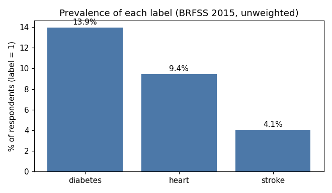
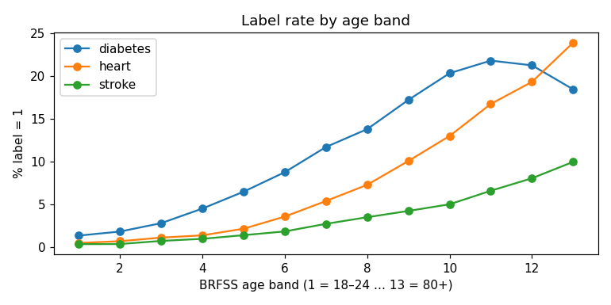
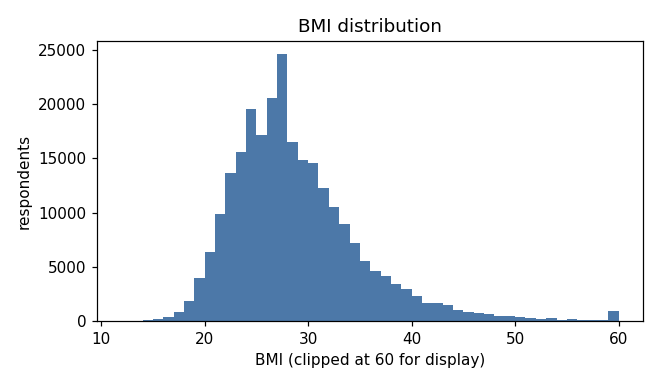
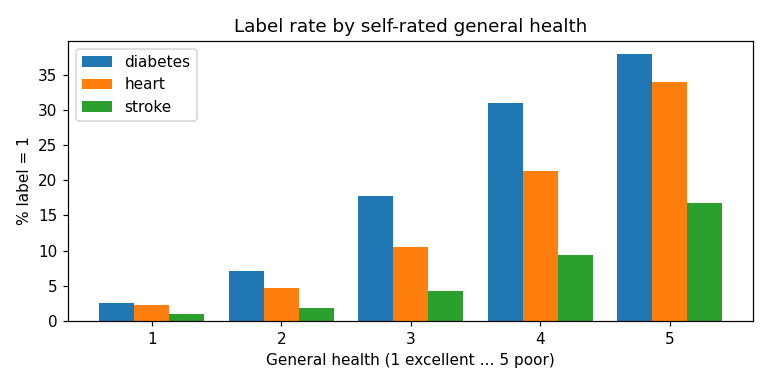

# Data card — CDC BRFSS Diabetes Health Indicators

*Generated by `python -m ml.data.data_card` from `ml/data/stats.json`. Do not edit by hand.*

## Source

| | |
|---|---|
| Name | CDC Diabetes Health Indicators (UCI ML Repository id 891) |
| DOI | 10.24432/C53919 — <https://doi.org/10.24432/C53919> |
| Citation (UCI) | "CDC Diabetes Health Indicators [Dataset]. (2017). UCI Machine Learning Repository. https://doi.org/10.24432/C53919." |
| Same data on Kaggle | `alexteboul/diabetes-health-indicators-dataset`, file `diabetes_binary_health_indicators_BRFSS2015.csv` |
| Underlying survey | US CDC Behavioral Risk Factor Surveillance System (BRFSS), funded by the CDC |
| File used | `data/raw/diabetes_binary_health_indicators_BRFSS2015.csv` (downloaded by `python -m ml.data.download`, git-ignored) |
| Prepared file hash (SHA-256) | `2f3939868b6b6653d84458193a2c94280921ff5a3b2849adc18b1b307be55cbc` |

### Licence

- UCI page, licence field, verbatim: **"See linked dataset for licensing information."** (links to the Kaggle page).
- Kaggle dataset licence field (read from the Kaggle API, `licenseName`), verbatim: **"CC0: Public Domain"**.
- The underlying BRFSS data is US federal (CDC) public survey data.

Finding: licence is **CC0: Public Domain** as stated by the Kaggle publisher. We have not seen a separate
CDC licence statement for this derived file. UCI asks users to follow the acknowledgement policy of the
original dataset site.

## How the data was collected

BRFSS is an annual **telephone survey** (landline and mobile) of US adults. All answers are
**self-reported**. The cleaned file has one row per respondent, 21 inputs + label, no missing values
(rows with missing answers were dropped by the Kaggle author). Survey weights are not included.

## What the labels mean

| Disease key | Column | Meaning (BRFSS wording) | Positives | Prevalence (unweighted) |
|---|---|---|---|---|
| `diabetes` | `Diabetes_binary` | 35,346 | 13.93% |
| `heart` | `HeartDiseaseorAttack` | 23,893 | 9.42% |
| `stroke` | `Stroke` | 10,292 | 4.06% |

Labels are **"ever told / ever had"**, from a single cross-sectional survey. They describe whether
a person has *already* been told they have the condition — not future risk.

Label overlap: diabetes & heart 7,878 · diabetes & stroke 3,268 ·
heart & stroke 3,937. No label is used as an input to any model (D-19).

## Size and duplicates

- Rows: **253,680**
- Exact duplicate rows (all 22 columns): **24,206** (9.5%)
- Duplicates on the 14 model inputs only: **79,790** (31.5%)

Duplicates are kept (the answers are coarse, so different people can give identical answers).
Phase 3 also reports test metrics on a de-duplicated test set as a robustness check (SPEC §3.4).

## Splits

Per disease, stratified on that disease's label, seed 42: train 60% / calibration 20% / test 20%;
calibration is halved into cal-A (isotonic calibration) and cal-B (thresholds, conformal).
Row indices (not data) are in `ml/data/splits/<disease>.json`. Format: n (prevalence).

| Disease | train | cal-A | cal-B | test |
|---|---|---|---|---|
| diabetes | 152,208 (13.93%) | 25,368 (13.93%) | 25,368 (13.93%) | 50,736 (13.93%) |
| heart | 152,208 (9.42%) | 25,368 (9.42%) | 25,368 (9.42%) | 50,736 (9.42%) |
| stroke | 152,208 (4.06%) | 25,368 (4.06%) | 25,368 (4.06%) | 50,736 (4.06%) |

## Features (model inputs, SPEC §3.3)

| Feature | Question shown to user | Type / values | Validation |
|---|---|---|---|
| `Age` | Your age (years) | int → mapped to BRFSS 13 bands (1 = 18–24, 2 = 25–29 … 12 = 75–79, 13 = 80+) | 18–120; < 18 blocked |
| `Sex` | Sex assigned at birth (used only for risk calculation) | 0 female / 1 male / "prefer not to say" | see D-9 |
| `BMI` | Height (cm) and weight (kg) → BMI computed | float | height 120–220, weight 30–250, BMI 12–70 |
| `HighBP` | Has a doctor or nurse ever told you that you have high blood pressure? | 0/1 | required |
| `HighChol` | … ever told you that your cholesterol is high? | 0/1 | required |
| `Smoker` | Have you smoked at least 100 cigarettes (5 packs) in your life? | 0/1 | required |
| `PhysActivity` | In the past 30 days, did you do any physical activity or exercise other than your regular job? | 0/1 | required |
| `Fruits` | Do you eat fruit at least once a day? | 0/1 | required |
| `Veggies` | Do you eat vegetables at least once a day? | 0/1 | required |
| `HvyAlcoholConsump` | Do you drink more than 14 drinks a week (men) / 7 a week (women)? | 0/1 | required |
| `GenHlth` | In general, how is your health? | 1 excellent … 5 poor | required |
| `MentHlth` | In the past 30 days, how many days was your mental health not good? | 0–30 | required |
| `PhysHlth` | In the past 30 days, how many days was your physical health not good? | 0–30 | required |
| `DiffWalk` | Do you have serious difficulty walking or climbing stairs? | 0/1 | required |

BMI in the file: 1st percentile 18, median 27, 99th percentile 50,
max 98. 584 rows have BMI > 70, which the app's validation (12–70)
would reject; they are kept in training as recorded.

## Fairness-only columns (never model inputs, never asked in the app — D-6)

`Income`, `Education`, `AnyHealthcare`, `NoDocbcCost`, `CholCheck`. Used only to audit model behaviour across groups (SPEC §4.7).

## Limitations

1. US population, 2014/2015; not validated on Indian users.
2. Smokeless tobacco (gutka, khaini) and bidis, common in India, are not captured; `Smoker` is "ever smoked 100 cigarettes" and cannot return to 0 after quitting.
3. BMI risk thresholds differ for South Asians; the model uses raw BMI, guidance uses Asian cut-offs.
4. Sex is binary in the data; there is no data for intersex or non-binary people.
5. Survey weights are not in the cleaned file, so prevalence here is not nationally representative.
6. Answers are self-reported and can be wrong; "ever told" labels exclude undiagnosed people (label noise, likely under-counting cases).
7. Cross-sectional survey: labels describe conditions people already have, so the models estimate similarity to people with the condition, not future risk. Some answers (e.g. general health, difficulty walking, physical activity) may be consequences of the condition, not causes.
8. `Diabetes_binary` merges prediabetes with diabetes; the models cannot tell them apart.
9. `HeartDiseaseorAttack` merges coronary heart disease and heart attack.
10. Age is only available in 5-year bands (13 bands, 80+ open-ended); BMI is rounded to an integer.
11. Source year is inconsistent between sources: the Kaggle page and file name say BRFSS 2015, while the UCI page links CDC's BRFSS 2014 annual data page. We treat it as BRFSS 2015 (the file name) and record the discrepancy.
12. The cleaning done by the Kaggle author (dropping rows with missing answers, recoding) is not fully documented, so people who skipped questions are excluded in an unknown way.

## Exploratory analysis

Rates rise steeply with age band and with worse self-rated general health for all three labels.
These are associations in survey data, not causes.

## Other data

The Pune Clinical Risk Synthetic Dataset (`data/synthetic/`) is synthetic. It is used only for demo
profiles and stress tests and never to train or evaluate the models (D-4).
