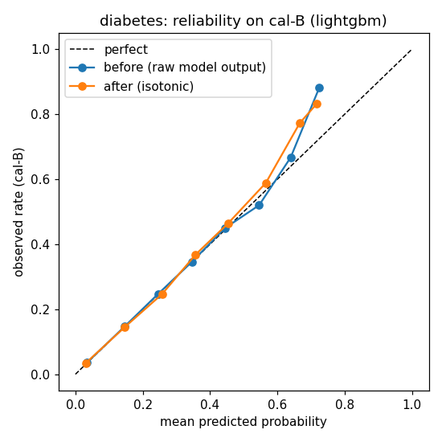
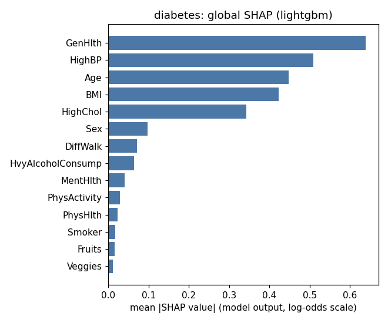

# Model card — diabetes (diabetes-v1.0.0)

*Generated from `ml/artifacts/diabetes/model_meta.json` by `ml/training/model_card.py`. Do not edit by hand.*

## Model details

- Version `diabetes-v1.0.0`, created 2026-10-28T12:24:06+00:00. Data hash `2f3939868b6b6653…`.
- Production model: **LightGBM** with isotonic calibration. Selection: highest cal-B AUROC (0.8254).
- Rule: highest cal-B AUROC unless another model is within 0.005 AUROC and has a better calibrated Brier score; ties go to the simpler model.
- Inputs: the 14 self-reported answers in SPEC §3.3 (Age, Sex, BMI, HighBP, HighChol, Smoker, PhysActivity, Fruits, Veggies, HvyAlcoholConsump, GenHlth, MentHlth, PhysHlth, DiffWalk).
- Output: a calibrated probability turned into a screening band (low / moderate / high), plus an
  abstention decision (conformal prediction set and out-of-distribution check).
- Libraries: python 3.13.0, scikit-learn 1.6.1, lightgbm 4.7.0, torch 2.6.0+cpu, shap 0.51.0, fairlearn 0.15.0, numpy 2.2.0, pandas 2.2.3.

## Intended use

Screening and care navigation in the VITALNEX MVP: show how similar a person's answers are to people
in a US survey who reported diabetes or prediabetes (BRFSS: ever told by a doctor), explain the main contributing answers, and route to a next-step
category. High and uncertain results go to clinician review. Users are dummy accounts (MVP).

## Out-of-scope use

- Diagnosis, or ruling a condition in or out. The label is "ever told", not a clinical test.
- Predicting future (e.g. 10-year) risk — the data is cross-sectional.
- Choosing, naming or dosing medicines.
- Use on people under 18, or as validated for Indian populations (it is not).
- Any automatic decision without the safety rules and clinician review around it.

## Factors

Audited groups (test set): sex, age group (18–39 / 40–59 / 60+), income, education, healthcare
coverage, cost barrier to seeing a doctor. Income, education, coverage and cost barrier are audit-only
columns: never model inputs and never asked in the app.

## Metrics

- Discrimination: AUROC. Calibration: Brier score, expected calibration error (10 bins).
- Screening: recall at t_mod (share of true cases flagged moderate or high), precision at t_high.
- Uncertainty: 95% bootstrap intervals (500 resamples of the test set).
- Abstention: conformal coverage per class (target 90%) and abstention rate.

## Evaluation data

Test split: 50,736 rows (20%, stratified, seed 42), used once after model choice.
Prevalence 13.9%.

## Training data

CDC BRFSS 2015 Diabetes Health Indicators (UCI id 891, DOI 10.24432/C53919, Kaggle licence
"CC0: Public Domain"). See `docs/data_card.md`. Train 152,208 rows (60%);
calibration cal-A 25,368 (isotonic) and cal-B 25,368
(model comparison, thresholds, conformal).

## Quantitative analyses

### Model comparison

| Model | CV AUROC (train) | cal-B AUROC | cal-B Brier raw | cal-B Brier calibrated | test AUROC | test Brier | test recall@t_mod | fit s | best params |
|---|---|---|---|---|---|---|---|---|---|
| Logistic Regression | 0.820 | 0.819 | 0.1765 | 0.0988 | 0.817 | 0.0995 | 0.831 | 1.2 | `{"C": 0.01}` |
| LightGBM **(chosen)** | 0.826 | 0.825 | 0.0969 | 0.0971 | 0.824 | 0.0979 | 0.855 | 11.1 | `{"min_child_samples": 300, "num_leaves": 15}` |
| PyTorch MLP | 0.826 | 0.824 | 0.1747 | 0.0973 | 0.823 | 0.0980 | 0.818 | 27.4 | `{"lr": 0.001}` |

Each model's test recall uses its own t_mod from cal-B. Raw Brier for Logistic Regression and the MLP
is high by design (class weighting); compare calibrated Brier.

### Production model on test

| Metric | Value | 95% CI |
|---|---|---|
| AUROC | 0.824 | 0.819–0.828 |
| Brier | 0.0979 | 0.0963–0.0997 |
| Recall at t_mod | 0.855 | 0.847–0.862 |
| Precision at t_mod | 0.273 | — |
| Recall at t_high | 0.479 | — |
| Precision at t_high | 0.429 | — |

De-duplicated test set (7,568 duplicate rows removed): AUROC 0.804,
recall at t_mod 0.854, Brier 0.1116.

### Calibration (fitted on cal-A, measured on cal-B)

| | Brier | ECE (10 bins) |
|---|---|---|
| Before | 0.0969 | 0.0025 |
| After isotonic | 0.0971 | 0.0059 |

### Screening bands

t_mod = 0.1246 (largest threshold with recall ≥ 0.80 on cal-B).
t_high = 0.2774 (smallest threshold with precision >= 3x prevalence; target precision 0.418 =
3 × prevalence 0.139). These are screening bands, not clinical cut-offs.

| Band | share (cal-B) | share (test) | observed rate in band (test) | share of all true cases (test) |
|---|---|---|---|---|
| low | 56.8% | 56.3% | 3.6% | 14.5% |
| moderate | 28.0% | 28.1% | 18.6% | 37.6% |
| high | 15.2% | 15.6% | 42.9% | 47.9% |

### Abstention

Mondrian split conformal, α = 0.1 per class on cal-B (q0 = 0.2774,
q1 = 0.9345). OOD: IsolationForest(n_estimators=200), threshold = 99th
percentile of train scores.

| | Test |
|---|---|
| Coverage, true negatives | 0.901 |
| Coverage, true positives | 0.903 |
| Abstained (conformal) | 36.2% |
| Out-of-distribution | 1.0% |
| Abstained (total) | 36.8% |
| Abstained among true negatives / positives | 35.4% / 45.4% |

### Explainability (SHAP, TreeExplainer)

Mean |SHAP| on 2000 random cal-B rows, raw model output (log-odds); background = 200 train rows.

| Rank | Feature | mean abs SHAP |
|---|---|---|
| 1 | `GenHlth` | 0.6387 |
| 2 | `HighBP` | 0.5091 |
| 3 | `Age` | 0.4486 |
| 4 | `BMI` | 0.4227 |
| 5 | `HighChol` | 0.3430 |
| 6 | `Sex` | 0.0970 |
| 7 | `DiffWalk` | 0.0715 |
| 8 | `HvyAlcoholConsump` | 0.0634 |
| 9 | `MentHlth` | 0.0400 |
| 10 | `PhysActivity` | 0.0292 |
| 11 | `PhysHlth` | 0.0226 |
| 12 | `Smoker` | 0.0171 |
| 13 | `Fruits` | 0.0154 |
| 14 | `Veggies` | 0.0109 |

### Fairness (test set)

flagged = calibrated p >= t_mod (moderate or high band); test set; metrics on all rows, abstention reported separately. Gaps are reported, not judged against any legal rule.

**Sex** — max gap: recall 0.017, FPR 0.064, precision 0.008, abstention 0.051

| Group | n | positives | recall | FPR | precision | mean predicted | observed | abstention |
|---|---|---|---|---|---|---|---|---|
| female | 28,430 | 3,671 | 0.847 | 0.342 | 0.269 | 0.130 | 0.129 | 34.5% |
| male | 22,306 | 3,398 | 0.864 | 0.405 | 0.277 | 0.149 | 0.152 | 39.6% |
**AgeGroup** — max gap: recall 0.509, FPR 0.512, precision 0.078, abstention 0.409

| Group | n | positives | recall | FPR | precision | mean predicted | observed | abstention |
|---|---|---|---|---|---|---|---|---|
| 18-39 | 7,654 | 245 | 0.396 | 0.051 | 0.204 | 0.028 | 0.032 | 8.6% |
| 40-59 | 18,562 | 2,006 | 0.792 | 0.280 | 0.255 | 0.109 | 0.108 | 31.5% |
| 60+ | 24,520 | 4,818 | 0.905 | 0.563 | 0.282 | 0.195 | 0.196 | 49.5% |
**Income** — max gap: recall 0.136, FPR 0.272, precision 0.106, abstention 0.126

| Group | n | positives | recall | FPR | precision | mean predicted | observed | abstention |
|---|---|---|---|---|---|---|---|---|
| high (>=$50k) | 26,604 | 2,506 | 0.778 | 0.273 | 0.229 | 0.100 | 0.094 | 31.4% |
| low (<$25k) | 11,573 | 2,664 | 0.914 | 0.545 | 0.334 | 0.207 | 0.230 | 44.0% |
| mid ($25-50k) | 12,559 | 1,899 | 0.874 | 0.440 | 0.261 | 0.157 | 0.151 | 41.5% |
**Education** — max gap: recall 0.076, FPR 0.174, precision 0.055, abstention 0.085

| Group | n | positives | recall | FPR | precision | mean predicted | observed | abstention |
|---|---|---|---|---|---|---|---|---|
| high school or less | 15,325 | 2,988 | 0.899 | 0.494 | 0.306 | 0.184 | 0.195 | 42.7% |
| more than high school | 35,411 | 4,081 | 0.823 | 0.320 | 0.251 | 0.118 | 0.115 | 34.2% |
**AnyHealthcare** — max gap: recall 0.033, FPR 0.070, precision 0.011, abstention 0.058

| Group | n | positives | recall | FPR | precision | mean predicted | observed | abstention |
|---|---|---|---|---|---|---|---|---|
| has coverage | 48,246 | 6,781 | 0.856 | 0.373 | 0.273 | 0.139 | 0.141 | 37.0% |
| no coverage | 2,490 | 288 | 0.823 | 0.303 | 0.262 | 0.122 | 0.116 | 31.2% |
**NoDocbcCost** — max gap: recall 0.034, FPR 0.071, precision 0.039, abstention 0.017

| Group | n | positives | recall | FPR | precision | mean predicted | observed | abstention |
|---|---|---|---|---|---|---|---|---|
| cost barrier | 4,281 | 766 | 0.885 | 0.434 | 0.307 | 0.177 | 0.179 | 38.3% |
| no cost barrier | 46,455 | 6,303 | 0.851 | 0.363 | 0.269 | 0.135 | 0.136 | 36.6% |

## Ethical considerations

- Labels are self-reported diagnoses; people who are undiagnosed count as negatives, so the model
  learns "diagnosed" as much as "has the condition". Groups with less access to care may be
  under-diagnosed and therefore under-flagged.
- Some inputs (general health, difficulty walking, physical health days) may be consequences of the
  condition, so explanations describe associations, not causes or things to fix.
- Results are always shown with "similar to people who have been told they have…" wording, never as
  a diagnosis, and emergency symptoms bypass the model.

## Caveats and recommendations

- US 2014/2015 survey data; not validated on Indian users. Smokeless tobacco and bidis are not captured.
- Survey weights are unavailable, so prevalence and precision are not nationally representative.
- About 20% of true cases fall in the Low band by design (recall target 0.80) — stated openly to users.

### Flags for the team

- band 'low' holds 56.3% of test people (> 50%)
- abstention 36.8% on test (> 30%)
- isotonic calibration did not improve Brier on cal-B
- AgeGroup: recall gap 0.509 > 0.1
- Income: recall gap 0.136 > 0.1
