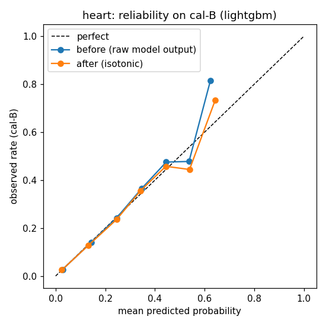
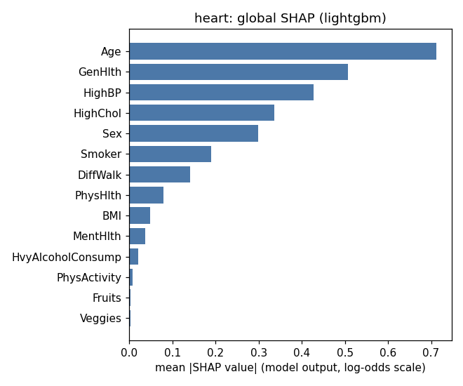

# Model card — heart (heart-v1.0.0)

*Generated from `ml/artifacts/heart/model_meta.json` by `ml/training/model_card.py`. Do not edit by hand.*

## Model details

- Version `heart-v1.0.0`, created 2026-10-28T12:24:51+00:00. Data hash `2f3939868b6b6653…`.
- Production model: **LightGBM** with isotonic calibration. Selection: highest cal-B AUROC (0.8429).
- Rule: highest cal-B AUROC unless another model is within 0.005 AUROC and has a better calibrated Brier score; ties go to the simpler model.
- Inputs: the 14 self-reported answers in SPEC §3.3 (Age, Sex, BMI, HighBP, HighChol, Smoker, PhysActivity, Fruits, Veggies, HvyAlcoholConsump, GenHlth, MentHlth, PhysHlth, DiffWalk).
- Output: a calibrated probability turned into a screening band (low / moderate / high), plus an
  abstention decision (conformal prediction set and out-of-distribution check).
- Libraries: python 3.13.0, scikit-learn 1.6.1, lightgbm 4.7.0, torch 2.6.0+cpu, shap 0.51.0, fairlearn 0.15.0, numpy 2.2.0, pandas 2.2.3.

## Intended use

Screening and care navigation in the VITALNEX MVP: show how similar a person's answers are to people
in a US survey who reported coronary heart disease or heart attack (BRFSS: ever reported), explain the main contributing answers, and route to a next-step
category. High and uncertain results go to clinician review. Users are dummy accounts (MVP).

## Out-of-scope use

- Diagnosis, or ruling a condition in or out. The label is "ever told", not a clinical test.
- Predicting future (e.g. 10-year) risk — the data is cross-sectional.
- Choosing, naming or dosing medicines.
- Use on people under 18, or as validated for Indian populations (it is not).
- Any automatic decision without the safety rules and clinician review around it.

## Factors

Audited groups (test set): sex, age group (18–39 / 40–59 / 60+), income, education, healthcare
coverage, cost barrier to seeing a doctor. Income, education, coverage and cost barrier are audit-only
columns: never model inputs and never asked in the app.

## Metrics

- Discrimination: AUROC. Calibration: Brier score, expected calibration error (10 bins).
- Screening: recall at t_mod (share of true cases flagged moderate or high), precision at t_high.
- Uncertainty: 95% bootstrap intervals (500 resamples of the test set).
- Abstention: conformal coverage per class (target 90%) and abstention rate.

## Evaluation data

Test split: 50,736 rows (20%, stratified, seed 42), used once after model choice.
Prevalence 9.4%.

## Training data

CDC BRFSS 2015 Diabetes Health Indicators (UCI id 891, DOI 10.24432/C53919, Kaggle licence
"CC0: Public Domain"). See `docs/data_card.md`. Train 152,208 rows (60%);
calibration cal-A 25,368 (isotonic) and cal-B 25,368
(model comparison, thresholds, conformal).

## Quantitative analyses

### Model comparison

| Model | CV AUROC (train) | cal-B AUROC | cal-B Brier raw | cal-B Brier calibrated | test AUROC | test Brier | test recall@t_mod | fit s | best params |
|---|---|---|---|---|---|---|---|---|---|
| Logistic Regression | 0.839 | 0.841 | 0.1690 | 0.0712 | 0.839 | 0.0714 | 0.847 | 1.3 | `{"C": 0.01}` |
| LightGBM **(chosen)** | 0.840 | 0.843 | 0.0709 | 0.0710 | 0.842 | 0.0711 | 0.838 | 8.3 | `{"min_child_samples": 300, "num_leaves": 15}` |
| PyTorch MLP | 0.840 | 0.843 | 0.1731 | 0.0711 | 0.840 | 0.0712 | 0.820 | 21.8 | `{"lr": 0.001}` |

Each model's test recall uses its own t_mod from cal-B. Raw Brier for Logistic Regression and the MLP
is high by design (class weighting); compare calibrated Brier.

### Production model on test

| Metric | Value | 95% CI |
|---|---|---|
| AUROC | 0.842 | 0.836–0.848 |
| Brier | 0.0711 | 0.0695–0.0728 |
| Recall at t_mod | 0.838 | 0.828–0.849 |
| Precision at t_mod | 0.224 | — |
| Recall at t_high | 0.624 | — |
| Precision at t_high | 0.301 | — |

De-duplicated test set (7,740 duplicate rows removed): AUROC 0.826,
recall at t_mod 0.836, Brier 0.0814.

### Calibration (fitted on cal-A, measured on cal-B)

| | Brier | ECE (10 bins) |
|---|---|---|
| Before | 0.0709 | 0.0033 |
| After isotonic | 0.0710 | 0.0032 |

### Screening bands

t_mod = 0.1026 (largest threshold with recall ≥ 0.80 on cal-B).
t_high = 0.1607 (smallest threshold with precision >= 3x prevalence; target precision 0.283 =
3 × prevalence 0.094). These are screening bands, not clinical cut-offs.

| Band | share (cal-B) | share (test) | observed rate in band (test) | share of all true cases (test) |
|---|---|---|---|---|
| low | 65.7% | 64.8% | 2.3% | 16.2% |
| moderate | 15.1% | 15.7% | 12.9% | 21.4% |
| high | 19.2% | 19.5% | 30.1% | 62.4% |

### Abstention

Mondrian split conformal, α = 0.1 per class on cal-B (q0 = 0.2519,
q1 = 0.9503). OOD: IsolationForest(n_estimators=200), threshold = 99th
percentile of train scores.

| | Test |
|---|---|
| Coverage, true negatives | 0.926 |
| Coverage, true positives | 0.926 |
| Abstained (conformal) | 38.0% |
| Out-of-distribution | 1.1% |
| Abstained (total) | 38.5% |
| Abstained among true negatives / positives | 37.2% / 50.6% |

### Explainability (SHAP, TreeExplainer)

Mean |SHAP| on 2000 random cal-B rows, raw model output (log-odds); background = 200 train rows.

| Rank | Feature | mean abs SHAP |
|---|---|---|
| 1 | `Age` | 0.7115 |
| 2 | `GenHlth` | 0.5071 |
| 3 | `HighBP` | 0.4276 |
| 4 | `HighChol` | 0.3360 |
| 5 | `Sex` | 0.2984 |
| 6 | `Smoker` | 0.1907 |
| 7 | `DiffWalk` | 0.1405 |
| 8 | `PhysHlth` | 0.0796 |
| 9 | `BMI` | 0.0491 |
| 10 | `MentHlth` | 0.0370 |
| 11 | `HvyAlcoholConsump` | 0.0215 |
| 12 | `PhysActivity` | 0.0082 |
| 13 | `Fruits` | 0.0030 |
| 14 | `Veggies` | 0.0023 |

### Fairness (test set)

flagged = calibrated p >= t_mod (moderate or high band); test set; metrics on all rows, abstention reported separately. Gaps are reported, not judged against any legal rule.

**Sex** — max gap: recall 0.103, FPR 0.141, precision 0.042, abstention 0.049

| Group | n | positives | recall | FPR | precision | mean predicted | observed | abstention |
|---|---|---|---|---|---|---|---|---|
| female | 28,048 | 2,013 | 0.779 | 0.240 | 0.201 | 0.074 | 0.072 | 36.3% |
| male | 22,688 | 2,765 | 0.882 | 0.381 | 0.243 | 0.123 | 0.122 | 41.2% |
**AgeGroup** — max gap: recall 0.783, FPR 0.518, precision 0.139, abstention 0.522

| Group | n | positives | recall | FPR | precision | mean predicted | observed | abstention |
|---|---|---|---|---|---|---|---|---|
| 18-39 | 7,761 | 93 | 0.118 | 0.014 | 0.095 | 0.010 | 0.012 | 5.1% |
| 40-59 | 18,449 | 941 | 0.660 | 0.153 | 0.188 | 0.052 | 0.051 | 27.7% |
| 60+ | 24,526 | 3,744 | 0.901 | 0.532 | 0.234 | 0.156 | 0.153 | 57.2% |
**Income** — max gap: recall 0.120, FPR 0.278, precision 0.070, abstention 0.188

| Group | n | positives | recall | FPR | precision | mean predicted | observed | abstention |
|---|---|---|---|---|---|---|---|---|
| high (>=$50k) | 26,642 | 1,556 | 0.763 | 0.203 | 0.189 | 0.065 | 0.058 | 31.0% |
| low (<$25k) | 11,716 | 1,873 | 0.883 | 0.481 | 0.259 | 0.148 | 0.160 | 49.8% |
| mid ($25-50k) | 12,378 | 1,349 | 0.864 | 0.364 | 0.225 | 0.112 | 0.109 | 43.9% |
**Education** — max gap: recall 0.051, FPR 0.168, precision 0.027, abstention 0.109

| Group | n | positives | recall | FPR | precision | mean predicted | observed | abstention |
|---|---|---|---|---|---|---|---|---|
| high school or less | 15,334 | 2,037 | 0.868 | 0.421 | 0.240 | 0.130 | 0.133 | 46.1% |
| more than high school | 35,402 | 2,741 | 0.816 | 0.253 | 0.213 | 0.081 | 0.077 | 35.2% |
**AnyHealthcare** — max gap: recall 0.096, FPR 0.096, precision 0.005, abstention 0.080

| Group | n | positives | recall | FPR | precision | mean predicted | observed | abstention |
|---|---|---|---|---|---|---|---|---|
| has coverage | 48,274 | 4,597 | 0.842 | 0.306 | 0.225 | 0.097 | 0.095 | 38.9% |
| no coverage | 2,462 | 181 | 0.746 | 0.210 | 0.220 | 0.066 | 0.074 | 30.9% |
**NoDocbcCost** — max gap: recall 0.018, FPR 0.031, precision 0.052, abstention 0.029

| Group | n | positives | recall | FPR | precision | mean predicted | observed | abstention |
|---|---|---|---|---|---|---|---|---|
| cost barrier | 4,339 | 563 | 0.822 | 0.329 | 0.271 | 0.107 | 0.130 | 41.1% |
| no cost barrier | 46,397 | 4,215 | 0.841 | 0.299 | 0.219 | 0.095 | 0.091 | 38.3% |

## Ethical considerations

- Labels are self-reported diagnoses; people who are undiagnosed count as negatives, so the model
  learns "diagnosed" as much as "has the condition". Groups with less access to care may be
  under-diagnosed and therefore under-flagged.
- Some inputs (general health, difficulty walking, physical health days) may be consequences of the
  condition, so explanations describe associations, not causes or things to fix.
- Results are always shown with "similar to people who have been told they have…" wording, never as
  a diagnosis, and emergency symptoms bypass the model.

## Caveats and recommendations

- US 2014/2015 survey data; not validated on Indian users. Smokeless tobacco and bidis are not captured.
- Survey weights are unavailable, so prevalence and precision are not nationally representative.
- About 20% of true cases fall in the Low band by design (recall target 0.80) — stated openly to users.

### Flags for the team

- band 'low' holds 64.8% of test people (> 50%)
- abstention 38.5% on test (> 30%)
- isotonic calibration did not improve Brier on cal-B
- Sex: recall gap 0.103 > 0.1
- AgeGroup: recall gap 0.783 > 0.1
- Income: recall gap 0.120 > 0.1
