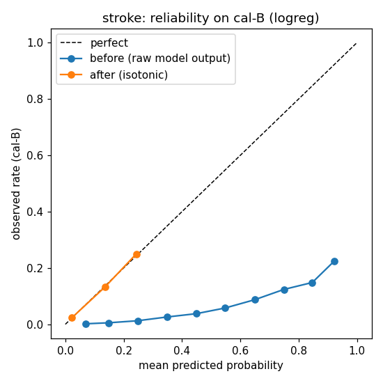
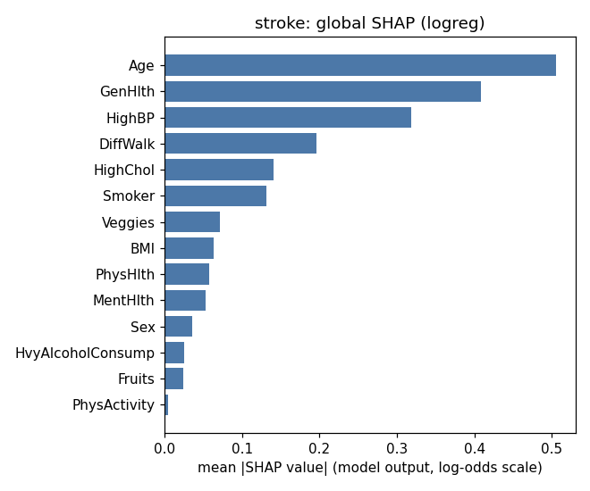

# Model card — stroke (stroke-v1.0.0)

*Generated from `ml/artifacts/stroke/model_meta.json` by `ml/training/model_card.py`. Do not edit by hand.*

## Model details

- Version `stroke-v1.0.0`, created 2026-10-28T12:25:37+00:00. Data hash `2f3939868b6b6653…`.
- Production model: **Logistic Regression** with isotonic calibration. Selection: highest cal-B AUROC (0.8081).
- Rule: highest cal-B AUROC unless another model is within 0.005 AUROC and has a better calibrated Brier score; ties go to the simpler model.
- Inputs: the 14 self-reported answers in SPEC §3.3 (Age, Sex, BMI, HighBP, HighChol, Smoker, PhysActivity, Fruits, Veggies, HvyAlcoholConsump, GenHlth, MentHlth, PhysHlth, DiffWalk).
- Output: a calibrated probability turned into a screening band (low / moderate / high), plus an
  abstention decision (conformal prediction set and out-of-distribution check).
- Libraries: python 3.13.0, scikit-learn 1.6.1, lightgbm 4.7.0, torch 2.6.0+cpu, shap 0.51.0, fairlearn 0.15.0, numpy 2.2.0, pandas 2.2.3.

## Intended use

Screening and care navigation in the VITALNEX MVP: show how similar a person's answers are to people
in a US survey who reported stroke (BRFSS: ever told), explain the main contributing answers, and route to a next-step
category. High and uncertain results go to clinician review. Users are dummy accounts (MVP).

## Out-of-scope use

- Diagnosis, or ruling a condition in or out. The label is "ever told", not a clinical test.
- Predicting future (e.g. 10-year) risk — the data is cross-sectional.
- Choosing, naming or dosing medicines.
- Use on people under 18, or as validated for Indian populations (it is not).
- Any automatic decision without the safety rules and clinician review around it.

## Factors

Audited groups (test set): sex, age group (18–39 / 40–59 / 60+), income, education, healthcare
coverage, cost barrier to seeing a doctor. Income, education, coverage and cost barrier are audit-only
columns: never model inputs and never asked in the app.

## Metrics

- Discrimination: AUROC. Calibration: Brier score, expected calibration error (10 bins).
- Screening: recall at t_mod (share of true cases flagged moderate or high), precision at t_high.
- Uncertainty: 95% bootstrap intervals (500 resamples of the test set).
- Abstention: conformal coverage per class (target 90%) and abstention rate.

## Evaluation data

Test split: 50,736 rows (20%, stratified, seed 42), used once after model choice.
Prevalence 4.1%.

## Training data

CDC BRFSS 2015 Diabetes Health Indicators (UCI id 891, DOI 10.24432/C53919, Kaggle licence
"CC0: Public Domain"). See `docs/data_card.md`. Train 152,208 rows (60%);
calibration cal-A 25,368 (isotonic) and cal-B 25,368
(model comparison, thresholds, conformal).

## Quantitative analyses

### Model comparison

| Model | CV AUROC (train) | cal-B AUROC | cal-B Brier raw | cal-B Brier calibrated | test AUROC | test Brier | test recall@t_mod | fit s | best params |
|---|---|---|---|---|---|---|---|---|---|
| Logistic Regression **(chosen)** | 0.811 | 0.808 | 0.1824 | 0.0366 | 0.810 | 0.0364 | 0.792 | 1.2 | `{"C": 0.01}` |
| LightGBM | 0.811 | 0.807 | 0.0366 | 0.0367 | 0.810 | 0.0363 | 0.801 | 6.5 | `{"min_child_samples": 300, "num_leaves": 15}` |
| PyTorch MLP | 0.811 | 0.808 | 0.1770 | 0.0366 | 0.811 | 0.0363 | 0.802 | 24.5 | `{"lr": 0.001}` |

Each model's test recall uses its own t_mod from cal-B. Raw Brier for Logistic Regression and the MLP
is high by design (class weighting); compare calibrated Brier.

### Production model on test

| Metric | Value | 95% CI |
|---|---|---|
| AUROC | 0.810 | 0.801–0.818 |
| Brier | 0.0364 | 0.0351–0.0377 |
| Recall at t_mod | 0.792 | 0.774–0.809 |
| Precision at t_mod | 0.094 | — |
| Recall at t_high | 0.524 | — |
| Precision at t_high | 0.145 | — |

De-duplicated test set (8,217 duplicate rows removed): AUROC 0.790,
recall at t_mod 0.792, Brier 0.0430.

### Calibration (fitted on cal-A, measured on cal-B)

| | Brier | ECE (10 bins) |
|---|---|---|
| Before | 0.1824 | 0.3262 |
| After isotonic | 0.0366 | 0.0012 |

### Screening bands

t_mod = 0.0345 (largest threshold with recall ≥ 0.80 on cal-B).
t_high = 0.0877 (smallest threshold with precision >= 3x prevalence; target precision 0.122 =
3 × prevalence 0.041). These are screening bands, not clinical cut-offs.

| Band | share (cal-B) | share (test) | observed rate in band (test) | share of all true cases (test) |
|---|---|---|---|---|
| low | 66.2% | 65.9% | 1.3% | 20.8% |
| moderate | 19.2% | 19.4% | 5.6% | 26.7% |
| high | 14.6% | 14.7% | 14.5% | 52.4% |

### Abstention

Mondrian split conformal, α = 0.1 per class on cal-B (q0 = 0.1028,
q1 = 0.9842). OOD: IsolationForest(n_estimators=200), threshold = 99th
percentile of train scores.

| | Test |
|---|---|
| Coverage, true negatives | 0.910 |
| Coverage, true positives | 0.922 |
| Abstained (conformal) | 43.9% |
| Out-of-distribution | 1.0% |
| Abstained (total) | 44.4% |
| Abstained among true negatives / positives | 44.1% / 53.7% |

### Explainability (SHAP, LinearExplainer)

Mean |SHAP| on 2000 random cal-B rows, raw model output (log-odds); background = 200 train rows.

| Rank | Feature | mean abs SHAP |
|---|---|---|
| 1 | `Age` | 0.5049 |
| 2 | `GenHlth` | 0.4085 |
| 3 | `HighBP` | 0.3185 |
| 4 | `DiffWalk` | 0.1962 |
| 5 | `HighChol` | 0.1407 |
| 6 | `Smoker` | 0.1316 |
| 7 | `Veggies` | 0.0713 |
| 8 | `BMI` | 0.0629 |
| 9 | `PhysHlth` | 0.0578 |
| 10 | `MentHlth` | 0.0526 |
| 11 | `Sex` | 0.0360 |
| 12 | `HvyAlcoholConsump` | 0.0256 |
| 13 | `Fruits` | 0.0238 |
| 14 | `PhysActivity` | 0.0049 |

### Fairness (test set)

flagged = calibrated p >= t_mod (moderate or high band); test set; metrics on all rows, abstention reported separately. Gaps are reported, not judged against any legal rule.

**Sex** — max gap: recall 0.003, FPR 0.004, precision 0.001, abstention 0.035

| Group | n | positives | recall | FPR | precision | mean predicted | observed | abstention |
|---|---|---|---|---|---|---|---|---|
| female | 28,108 | 1,129 | 0.793 | 0.320 | 0.094 | 0.041 | 0.040 | 42.9% |
| male | 22,628 | 929 | 0.790 | 0.324 | 0.095 | 0.041 | 0.041 | 46.4% |
**AgeGroup** — max gap: recall 0.692, FPR 0.534, precision 0.019, abstention 0.591

| Group | n | positives | recall | FPR | precision | mean predicted | observed | abstention |
|---|---|---|---|---|---|---|---|---|
| 18-39 | 7,650 | 53 | 0.170 | 0.014 | 0.076 | 0.005 | 0.007 | 5.7% |
| 40-59 | 18,515 | 476 | 0.634 | 0.163 | 0.093 | 0.024 | 0.026 | 33.5% |
| 60+ | 24,571 | 1,529 | 0.862 | 0.548 | 0.095 | 0.064 | 0.062 | 64.8% |
**Income** — max gap: recall 0.244, FPR 0.361, precision 0.057, abstention 0.141

| Group | n | positives | recall | FPR | precision | mean predicted | observed | abstention |
|---|---|---|---|---|---|---|---|---|
| high (>=$50k) | 26,604 | 549 | 0.643 | 0.193 | 0.066 | 0.025 | 0.021 | 37.8% |
| low (<$25k) | 11,588 | 930 | 0.887 | 0.554 | 0.123 | 0.070 | 0.080 | 51.9% |
| mid ($25-50k) | 12,544 | 579 | 0.779 | 0.397 | 0.087 | 0.047 | 0.046 | 51.7% |
**Education** — max gap: recall 0.110, FPR 0.200, precision 0.019, abstention 0.106

| Group | n | positives | recall | FPR | precision | mean predicted | observed | abstention |
|---|---|---|---|---|---|---|---|---|
| high school or less | 15,493 | 926 | 0.852 | 0.462 | 0.105 | 0.058 | 0.060 | 51.8% |
| more than high school | 35,243 | 1,132 | 0.742 | 0.262 | 0.086 | 0.033 | 0.032 | 41.2% |
**AnyHealthcare** — max gap: recall 0.079, FPR 0.099, precision 0.015, abstention 0.076

| Group | n | positives | recall | FPR | precision | mean predicted | observed | abstention |
|---|---|---|---|---|---|---|---|---|
| has coverage | 48,192 | 1,963 | 0.795 | 0.327 | 0.094 | 0.041 | 0.041 | 44.8% |
| no coverage | 2,544 | 95 | 0.716 | 0.228 | 0.109 | 0.030 | 0.037 | 37.2% |
**NoDocbcCost** — max gap: recall 0.033, FPR 0.078, precision 0.035, abstention 0.009

| Group | n | positives | recall | FPR | precision | mean predicted | observed | abstention |
|---|---|---|---|---|---|---|---|---|
| cost barrier | 4,313 | 278 | 0.820 | 0.393 | 0.126 | 0.052 | 0.064 | 45.3% |
| no cost barrier | 46,423 | 1,780 | 0.787 | 0.315 | 0.090 | 0.040 | 0.038 | 44.4% |

## Ethical considerations

- Labels are self-reported diagnoses; people who are undiagnosed count as negatives, so the model
  learns "diagnosed" as much as "has the condition". Groups with less access to care may be
  under-diagnosed and therefore under-flagged.
- Some inputs (general health, difficulty walking, physical health days) may be consequences of the
  condition, so explanations describe associations, not causes or things to fix.
- Results are always shown with "similar to people who have been told they have…" wording, never as
  a diagnosis, and emergency symptoms bypass the model.

## Caveats and recommendations

- US 2014/2015 survey data; not validated on Indian users. Smokeless tobacco and bidis are not captured.
- Survey weights are unavailable, so prevalence and precision are not nationally representative.
- About 20% of true cases fall in the Low band by design (recall target 0.80) — stated openly to users.

### Flags for the team

- band 'low' holds 65.9% of test people (> 50%)
- abstention 44.4% on test (> 30%)
- AgeGroup: recall gap 0.692 > 0.1
- Income: recall gap 0.244 > 0.1
- Education: recall gap 0.110 > 0.1
